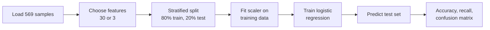
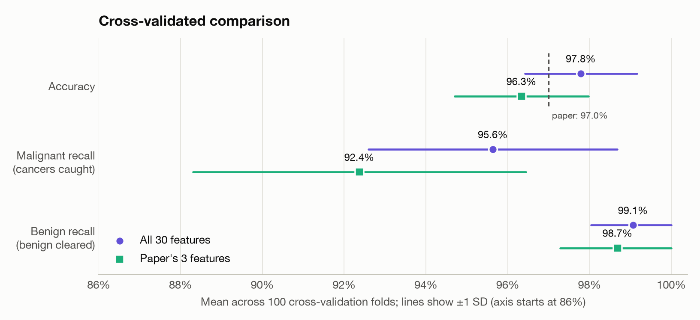

# Diagnostic Breast Cancer Classifier

This project trains a logistic regression model to classify breast masses as **malignant** or **benign** from measurements of cell nuclei. It compares a model using all 30 measurements against a three-feature model based on a 1994 paper by the researchers behind the dataset.

> **Key result:** Using all 30 features reached **97.8%** cross-validated accuracy and caught **95.6%** of cancers. The paper's three features came close with **96.3%** accuracy, but caught fewer cancers at **92.4%**.

*This is a learning project and is not a medical device. It should not be used to make diagnostic decisions.*

## The data

The project uses the Breast Cancer Wisconsin (Diagnostic) dataset, loaded through scikit-learn.

| Property | Value |
| --- | --- |
| Patients | 569 |
| Malignant | 212 (37.3%) |
| Benign | 357 (62.7%) |
| Features | 30 |
| Missing values | 0 |

Each sample comes from a digitized image of a fine needle aspirate (FNA) of a breast mass. Ten properties are measured for the cell nuclei: radius, texture, perimeter, area, smoothness, compactness, concavity, concave points, symmetry and fractal dimension. Each property is summarized three ways (mean, standard error and "worst" or extreme value), which gives 30 features.

## How it works



1. **Split the data.** 455 samples are used for training and 114 for testing. Stratifying keeps the malignant and benign proportions the same in both sets.
2. **Scale the features.** `StandardScaler` gives each feature a mean of 0 and a standard deviation of 1. Area values reach the thousands while smoothness values are around 0.1, so without scaling the features would not be on a comparable footing. The scaler is fit only on training data so that no information leaks in from the test set.
3. **Train the model.** Logistic regression learns one weight per feature and turns the weighted sum into a probability of each diagnosis.
4. **Evaluate it.** The model is scored on the 114 held-out patients. A confusion matrix shows which kinds of mistakes it makes.

## Testing the paper's idea

[Mangasarian, Street and Wolberg (1994)](https://cdn.aaai.org/Symposia/Spring/1994/SS-94-01/SS94-01-019.pdf) found that reducing the number of inputs improved generalization. Their best diagnostic classifier used a single separating plane and three features: **extreme area, extreme smoothness and mean texture**. They reported **97.0%** cross-validated accuracy.

`train_model_paper.py` tests those same three features with logistic regression. In scikit-learn, the paper's "extreme" values are named "worst".


Worst area separates the two groups most clearly. Smoothness and texture overlap much more, but they still add information. The trained three-feature model agrees, since its standardized weights are largest for area:

| Feature | Weight |
| --- | ---: |
| Worst area | -5.19 |
| Worst smoothness | -1.52 |
| Mean texture | -1.03 |

scikit-learn encodes benign as 1, so a negative weight means that higher values push the prediction toward **malignant**.

## Results

### Single test split

Both models were tested on the same 114 patients.


| Metric | All 30 features | Paper's 3 features |
| --- | ---: | ---: |
| Accuracy | 98.2% | 94.7% |
| Malignant recall | 97.6% (41/42) | 95.2% (40/42) |
| Benign recall | 98.6% (71/72) | 94.4% (68/72) |
| Missed cancers | 1 | 2 |
| False alarms | 1 | 4 |

### Cross-validation

One split of 114 patients can be lucky or unlucky, because a single patient moves accuracy by almost a full percentage point. For a more stable comparison, each model was also evaluated with 5-fold stratified cross-validation repeated 20 times, for 100 train/test rounds. Scaling was refit inside every round.



| Metric (mean ± SD) | All 30 features | Paper's 3 features |
| --- | ---: | ---: |
| Accuracy | 97.8% ± 1.4 | 96.3% ± 1.6 |
| Malignant recall | 95.6% ± 3.0 | 92.4% ± 4.1 |
| Benign recall | 99.1% ± 1.0 | 98.7% ± 1.4 |
| ROC AUC | 0.994 | 0.991 |

### What this means

- **The 30-feature model performed better here.** Its largest advantage is on malignant recall, which matters most because a missed cancer is the costliest error. Across the full dataset, that rate corresponds to roughly 9 missed cancers versus 16 for the three-feature model.
- **Three features still do remarkably well.** Keeping 10% of the inputs retains most of the performance, and a smaller model is easier to interpret.
- **The paper's 97.0% is close to this replication's 96.3%.** The two are not a like-for-like comparison, because the paper used a linear-programming classifier rather than logistic regression.

### Limitations

- The fold-to-fold ranges overlap, so the gap between the models is modest.
- The paper chose its three features from these same 569 patients, so the three-feature scores may be slightly optimistic.
- Everything was evaluated on one dataset from one institution. Performance on new clinical data is unknown.
- Both models use the default 0.5 decision threshold. A screening tool would likely lower the threshold for flagging malignancy to catch more cancers, at the cost of more false alarms.

## Run it yourself

```bash
git clone https://github.com/aarinkaramchandani-dev/Diagnostic-Breast-Cancer.git
cd Diagnostic-Breast-Cancer
python3 -m venv .venv
source .venv/bin/activate
pip install scikit-learn matplotlib numpy

python inspect_data.py         # explore the dataset
python train_model.py          # train on all 30 features
python train_model_paper.py    # train on the paper's 3 features
```

Each script prints its results and opens a plot window. Close the window to end the script.

## Project structure

```text
.
├── inspect_data.py         # Dataset summary and mean radius histogram
├── train_model.py          # 30-feature logistic regression
├── train_model_paper.py    # Three-feature model based on the paper
├── images/                 # Figures used in this README
└── README.md
```

## Reference

Mangasarian, O. L., Street, W. N., and Wolberg, W. H. (1994). [*Breast Cancer Diagnosis and Prognosis via Linear Programming*](https://cdn.aaai.org/Symposia/Spring/1994/SS-94-01/SS94-01-019.pdf). AAAI Technical Report SS-94-01.
