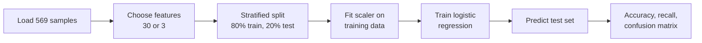
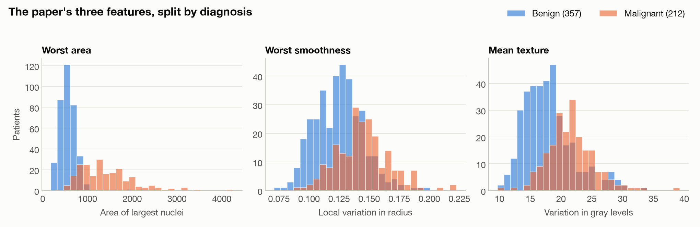
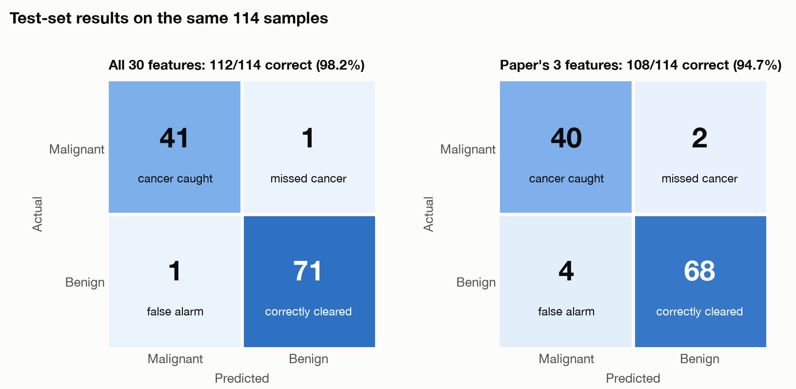

# Diagnostic Breast Cancer Classifier

This project trains a logistic regression model to classify breast masses as **malignant** or **benign** from measurements of cell nuclei. It compares a model using all 30 measurements against a three-feature model based on a 1994 paper by the researchers behind the dataset.

> **Key result:** On the same 114-sample test set, the 30-feature model classified **112** samples correctly (**98.2%**) and missed one malignant case. The three-feature model classified **108** correctly (**94.7%**) and missed two malignant cases. Repeated cross-validation, reported below, shows the same ordering with a smaller gap: **97.8%** versus **96.3%** accuracy.

*This is a learning project and is not a medical device. It should not be used to make diagnostic decisions.*

## The data

The project uses the Breast Cancer Wisconsin (Diagnostic) dataset, loaded through scikit-learn.

| Property | Value |
| --- | --- |
| Samples | 569 |
| Malignant | 212 (37.3%) |
| Benign | 357 (62.7%) |
| Features | 30 |
| Missing values | 0 |

Each sample comes from a digitized image of a fine needle aspirate (FNA) of a breast mass. Ten properties are measured for the cell nuclei: radius, texture, perimeter, area, smoothness, compactness, concavity, concave points, symmetry and fractal dimension. Each property is summarized three ways (mean, standard error and "worst" or extreme value), which gives 30 features.

## How it works



1. **Split the data.** 455 samples are used for training and 114 for testing. Stratifying keeps the malignant and benign proportions the same in both sets.
2. **Scale the features.** `StandardScaler` gives each feature in the training data a mean of 0 and a standard deviation of 1. Area values reach the thousands while smoothness values are around 0.1, so without scaling the features would not be on a comparable footing. The test data is transformed with the training statistics, so its values won't have exactly that mean and standard deviation, and no information leaks in from the test set.
3. **Train the model.** Logistic regression learns one weight per feature and turns the weighted sum into a probability of each diagnosis.
4. **Evaluate it.** The model is scored on the 114 held-out samples. A confusion matrix shows which kinds of mistakes it makes.

## An experiment inspired by the paper

[Mangasarian, Street and Wolberg (1994)](https://cdn.aaai.org/Symposia/Spring/1994/SS-94-01/SS94-01-019.pdf) found that reducing the number of inputs improved generalization. Their best diagnostic classifier used a single separating plane and three features: **extreme area, extreme smoothness and mean texture**. They reported **97.0%** cross-validated accuracy.

`train_model_paper.py` uses those same three features but trains logistic regression, so it is not a replication of the paper's method. In scikit-learn, the paper's "extreme" values are named "worst".



Worst area shows the clearest separation in these histograms. Smoothness and texture overlap more. In this fitted logistic regression model, area has the largest standardized coefficient magnitude:

| Feature | Weight |
| --- | ---: |
| Worst area | -5.19 |
| Worst smoothness | -1.52 |
| Mean texture | -1.03 |

scikit-learn encodes benign as 1, so a negative weight means that higher values push the prediction toward **malignant**.

## Results

### Single test split

Both models were tested on the same 114 samples.



| Metric | All 30 features | Paper's 3 features |
| --- | ---: | ---: |
| Accuracy | 98.2% | 94.7% |
| Malignant recall | 97.6% (41/42) | 95.2% (40/42) |
| Benign recall | 98.6% (71/72) | 94.4% (68/72) |
| Missed cancers | 1 | 2 |
| False alarms | 1 | 4 |

### Cross-validation

One split of 114 samples can be lucky or unlucky, because a single sample moves accuracy by almost a full percentage point. For a more stable comparison, `evaluate_models.py` also evaluates each model with 5-fold stratified cross-validation repeated 20 times, for 100 train/test rounds. Scaling is refit inside every round.


| Metric | All 30 features | Paper's 3 features |
| --- | ---: | ---: |
| Accuracy (mean ± SD) | 97.8% ± 1.4 | 96.3% ± 1.6 |
| Malignant recall (mean ± SD) | 95.6% ± 3.0 | 92.4% ± 4.1 |
| Benign recall (mean ± SD) | 99.1% ± 1.0 | 98.7% ± 1.4 |
| ROC AUC (mean) | 0.994 | 0.991 |

### What this means

- **The 30-feature model performed better here.** Its largest cross-validated difference is in malignant recall. Missing a malignant case is an important error to examine in this diagnostic task. On the single test set, it missed 1 malignant case versus 2 for the three-feature model.
- **Three features still do remarkably well.** Keeping 10% of the inputs retains most of the performance, and a smaller model is easier to interpret.
- **The paper's 97.0% is close to this experiment's 96.3%.** The two are not a like-for-like comparison, because the paper used a linear-programming classifier and its own evaluation rather than logistic regression with this cross-validation setup.

### Limitations

- The 100 cross-validation scores come from repeated splits of the same 569 samples, not 100 independent datasets. They do not establish how either model will perform on new clinical data.
- The paper chose its three features from these same 569 samples, so the three-feature scores may be slightly optimistic.
- The models use the default decision threshold. Changing the threshold for predicting malignancy would change the tradeoff between missed malignant cases and false alarms; this project does not choose a clinical threshold.

## Run it yourself

```bash
git clone https://github.com/aarinkaramchandani-dev/Diagnostic-Breast-Cancer.git
cd Diagnostic-Breast-Cancer
python3 -m venv .venv
source .venv/bin/activate
pip install scikit-learn matplotlib numpy

python inspect_data.py         # explore the dataset
python train_model.py          # train on all 30 features
python train_model_paper.py    # train on the paper's 3 features
python evaluate_models.py      # reproduce the README's metrics and figures
```

The first three scripts print their results and open a plot window. Close the window to end the script. `evaluate_models.py` prints every reported metric and saves the figures to `images/`.

## Project structure

```text
.
├── inspect_data.py         # Dataset summary and mean radius histogram
├── train_model.py          # 30-feature logistic regression
├── train_model_paper.py    # Three-feature model based on the paper
├── evaluate_models.py      # Cross-validation, README metrics and figures
├── images/                 # Figures used in this README
└── README.md
```

## Reference

Mangasarian, O. L., Street, W. N., and Wolberg, W. H. (1994). [*Breast Cancer Diagnosis and Prognosis via Linear Programming*](https://cdn.aaai.org/Symposia/Spring/1994/SS-94-01/SS94-01-019.pdf). AAAI Technical Report SS-94-01.
